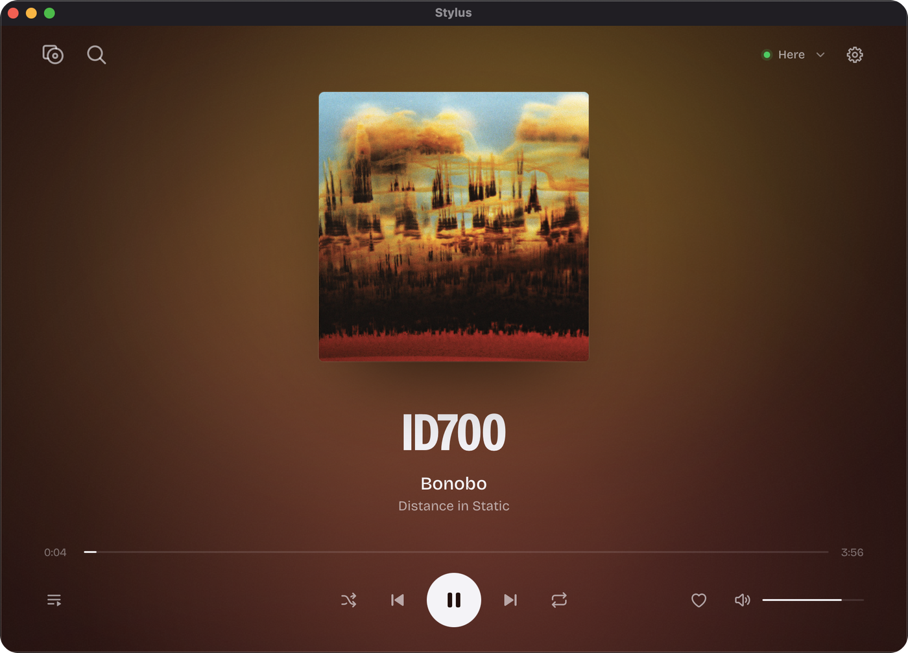

<p align="center">
  
</p>

# Stylus

A small Spotify player for macOS on Apple Silicon. This is a fork of [1905/stylus-spotify-mini-player](https://github.com/1905/stylus-spotify-mini-player) that also plays for **Spotify Free** accounts.

- **Premium:** Stylus plays by itself through the built-in player (librespot) and shows up as "This Mac" in your other Spotify apps.
- **Free:** Stylus plays through Spotify's web player in a hidden window, with Spotify's ads. That window shows only the login page.

The app is the same either way: the window tints to the album cover, the Library (playlists, Liked Songs, albums, artists, mixes) with search, a panel with what played and what comes next, lyrics under the title or instead of the cover (Settings → Appearance → Lyrics; the ❝ button hides them), a menu-bar mini player, media keys and Now Playing, control of your other Spotify Connect devices, and a local MCP server for AI tools.

## Install

Download **Stylus.dmg** from [the latest release](https://github.com/SandQuattro/stylus-spotify-mini-player/releases/latest) and drag Stylus to Applications, or install the cask:

```sh
brew install --cask SandQuattro/tap/stylus
```

Or build from source (below). Requirements: macOS 13 or later on Apple Silicon and a Spotify account.

The app is not signed with an Apple Developer ID. If macOS refuses to open it, run once:

```sh
xattr -dr com.apple.quarantine /Applications/Stylus.app
```

**Updates:** Stylus checks this fork's releases after launch and every 6 hours, downloads a signed update in the background and installs it when you quit. **Settings → Updates** shows the status; **Install updates automatically** turns it off. Updates work only when `Stylus.app` is in `/Applications` or `~/Applications`.

## Login

Select **Log in with Spotify**. Spotify's login page opens inside Stylus (OAuth with PKCE; no developer app needed). Passkeys don't work in that window; use a password or a one-time code. The login survives a restart. **Stylus → Log Out** in the app menu forgets it, the web player's session included.

## Free accounts: what is different

- Spotify's ads play as Spotify sends them. During an ad Stylus shows an ad card; skip and seek wait until it ends.
- Audio quality is set by Spotify's web player, so the quality setting is hidden.
- After a launch Stylus starts idle instead of on the last song.
- Your other Spotify apps list both "Web Player (Safari)" (Stylus's speaker) and "This Mac"; the second one plays nothing.
- Memory: about 450 MB in total, most of it the web player's page.

## Control Stylus from AI tools (MCP)

Open **Settings** (the cog) and turn on **MCP server**, then copy the connect text (**Claude Code** or **JSON config**) into your client:

```sh
claude mcp add --scope user --transport http stylus http://127.0.0.1:5590/mcp --header "Authorization: Bearer <key>"
```

31 tools: now playing, search, play, pause, next, seek, volume, queue, library and playlists, devices and transfer, like. The server listens on `127.0.0.1` only, runs only while Stylus is open with the setting on, and every request needs the key. Details: [docs/mcp.md](docs/mcp.md).

## Build from source

Requires [Rust](https://rustup.rs) 1.85 or later and Node.js 20 or later.

```sh
git clone https://github.com/SandQuattro/stylus-spotify-mini-player.git
cd stylus-spotify-mini-player
npm install
npx tauri build --bundles app   # → src-tauri/target/release/bundle/macos/Stylus.app
```

`make test` runs the frontend (vitest) and backend (cargo) tests.

### How it works

- **App shell:** [Tauri 2](https://tauri.app) with a plain JavaScript frontend.
- **Playback:** [librespot](https://github.com/librespot-org/librespot) 0.8 as a Spotify Connect device (Premium), or Spotify's web player in a hidden WKWebView window, driven over Spotify Connect (Free).
- **Library data:** Spotify's internal endpoints, the same ones the official apps use, through the player's own session.
- **State on disk:** `~/Library/Application Support/stylus/` holds the player credentials (`0600`), the session, settings, a list cache and the log `logs/stylus.log`. The web player's session lives in the app's WebKit data store.

## Report a problem

**File → Show Anonymized Logs in Finder** selects a log that contains only warnings, errors and login steps, with song, account and device names removed. Attach it to an issue.

## Disclaimer

Stylus is an independent project. It is not affiliated with, endorsed by or connected to Spotify. Spotify is a trademark of Spotify AB.

Stylus uses librespot and undocumented Spotify endpoints. Spotify can change or block them at any time, and Spotify's terms may not permit this use. Use Stylus at your own risk.

## License

[MIT](LICENSE)
